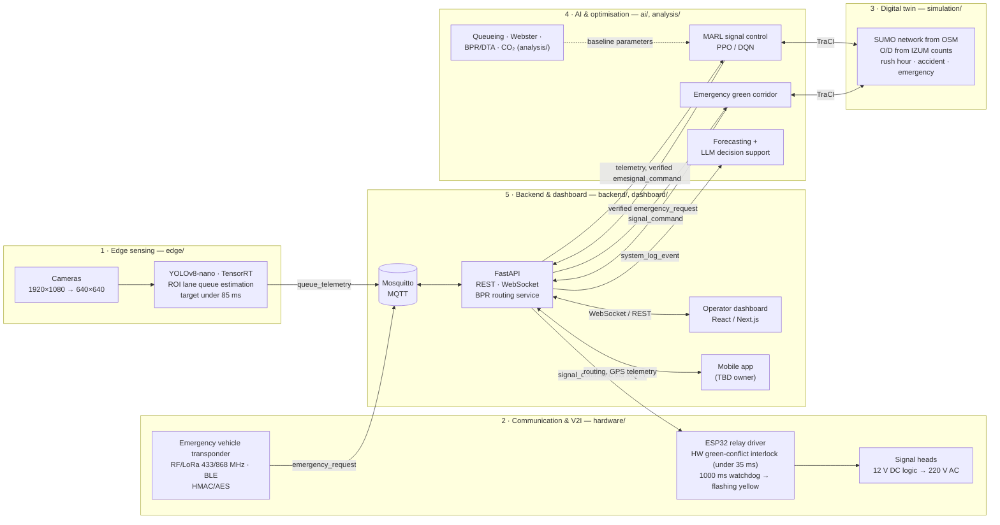

# Izmir Smart Corridor

**AI-Driven Adaptive Traffic Flow Optimization and Emergency Green-Corridor Management System Using Digital Twin Simulation and Edge V2I**

[](https://github.com/Decuayer/feng497-smart-corridor/actions/workflows/ci.yml)
[](LICENSE)


Izmir Smart Corridor is a multidisciplinary capstone project (FENG 497, Izmir University of Economics). It builds an adaptive traffic-signal control system for the Alsancak–Konak arterial network in Izmir. Edge cameras estimate lane queues. Emergency vehicles request priority over authenticated V2I radio links. A SUMO digital twin of the corridor is used to train and validate multi-agent reinforcement-learning signal controllers and a proactive emergency green-corridor algorithm. Operators supervise the system through a web dashboard. All validation happens in simulation and in hardware-in-the-loop testbenches; the system never interferes with live municipal controllers.

## Problem and objectives

Fixed-time signal plans on Izmir's central arteries react poorly to peak-hour demand, incidents and emergency vehicles. The project aims to:

- reduce travel time, intersection waiting time and CO₂ emissions with adaptive multi-agent signal control;
- cut emergency-vehicle transit time with a proactive green wave that pre-clears the next intersections on the vehicle's route;
- forecast short-term congestion and give operators grounded natural-language briefings;
- stay safe: every controller respects fixed signal limits, a hardware interlock prevents conflicting greens, and the system falls back to local adaptive Webster control if the network or the learned policy fails.

**Pilot area:** bounding box 38.4150–38.4410 N, 27.1250–27.1550 E. Six multi-phase intersections: Alsancak Station, Lozan, Montrö, Basmane, Çankaya, Konak Pier. A 3 km pilot corridor is used for the emergency KPI. Bornova, Karşıyaka, Balçova and Buca are modelled only as secondary regions for macro routing.

**Signal safety limits (all controllers):** min green 10 s · max green 60 s · yellow 3 s · all-red 1 s.

## Architecture



Message formats are defined in [`shared/contracts/`](shared/contracts/) and summarised in [`docs/interfaces.md`](docs/interfaces.md). More detail, including the team's deployment diagrams, is in [`docs/architecture/`](docs/architecture/).

## KPI targets

| KPI | Fixed-time baseline | Target |
|---|---|---|
| Average travel time (peak) | 24.5 min | 17.0 min |
| Intersection waiting time | 85 s | 55 s |
| Emergency transit time over 3 km | 12.0 min | 4.5 min |
| CO₂ emissions | 185 g/km | 148 g/km |
| Edge inference latency | — | under 85 ms |
| Fail-safe response | — | under 35 ms |

## Repository layout

```
.
├── ai/            MARL signal control, emergency green corridor, forecasting, LLM decision support (Demir)
├── analysis/      Queueing models, Webster baseline, BPR/DTA formulation, CO₂ and CAPEX/OPEX (Ayça)
├── backend/       FastAPI + MQTT/Mosquitto + WebSocket/REST, BPR routing service (Ario)
├── dashboard/     React/Next.js operator dashboard (Ario)
├── edge/          Camera data pipeline, YOLOv8-nano/TensorRT, ROI queue estimation (Nihat)
├── hardware/      V2I radio + auth, ESP32 relay board, fail-safe interlock, watchdog (Tolga)
├── simulation/    OSM→SUMO network, TraCI integration, O/D matrices, scenarios (Öykü)
├── shared/contracts/  Cross-team interfaces: intersection ids, MQTT topics, JSON Schemas (DRAFT)
├── data/          Data source documentation; raw/ and processed/ are gitignored
├── docs/          Architecture, ADRs, interface summary, meeting-notes template
├── scripts/       Repo-wide helper scripts (contract validation, size checks)
└── .github/       CODEOWNERS, PR/issue templates, CI workflow
```

## Prerequisites

| Tool | Version | Notes |
|---|---|---|
| Python | 3.10+ (**ASSUMPTION**: minimum not yet tested) | Tested with **Python 3.14.4** on macOS |
| SUMO | ≥ 1.18; tested with **1.28.0** | Supported install: the pip package **`eclipse-sumo`** (bundles `sumo`, `sumo-gui`, `netconvert`, `netgenerate`, and `tools/`), plus `traci` and `sumolib` |
| Node.js | current LTS | Dashboard only |

### Clone

```bash
git clone https://github.com/Decuayer/feng497-smart-corridor.git
cd feng497-smart-corridor
```

### Python environment and SUMO

```bash
python3 -m venv .venv
source .venv/bin/activate
pip install -r ai/prototype/requirements.txt      # installs eclipse-sumo, traci, sumolib, torch, ...

# SUMO_HOME must point at the SUMO bundled inside the venv:
export SUMO_HOME="$(python -c 'import sumo; print(sumo.SUMO_HOME)')"
sumo --version
```

With the pip package, `SUMO_HOME` is `<venv>/lib/python<X.Y>/site-packages/sumo`. Activating the venv puts the `sumo` binaries on `PATH`. Do **not** point `SUMO_HOME` at a Homebrew or system SUMO path unless that install actually exists. To make this permanent, add the `export` line to `.venv/bin/activate` or to your shell profile.

## Quick start per module

| Module | Quick start | Status |
|---|---|---|
| `ai/` | `cd ai/prototype && python evaluate.py` (legacy prototype; see [ai/README.md](ai/README.md) for known issues) | in progress |
| `simulation/` | see [simulation/README.md](simulation/README.md) | planned |
| `backend/` | see [backend/README.md](backend/README.md) | planned |
| `dashboard/` | see [dashboard/README.md](dashboard/README.md) | planned |
| `edge/` | `python edge/prototypes/izum_live_detection.py` (optional AGPL dependency; see [edge/README.md](edge/README.md)) | in progress |
| `hardware/` | see [hardware/README.md](hardware/README.md) | planned |
| `analysis/` | see [analysis/README.md](analysis/README.md) | planned |
| contracts | `pip install jsonschema pyyaml && python scripts/validate_contracts.py` | draft |

Configuration is read from environment variables. Copy [`.env.example`](.env.example) to `.env` and fill it in locally. `.env` is gitignored.

## Team and ownership

| Area | Owner | Folder |
|---|---|---|
| Digital twin: OSM→SUMO network, TraCI integration, O/D matrices, scenarios | Öykü Doğa Dabak (CE) | `simulation/` |
| MARL signal control, emergency green corridor, traffic forecasting and LLM decision support | Demir Cücü (CE) | `ai/` |
| Distributed backend (FastAPI, MQTT/Mosquitto, WebSocket, REST), BPR routing service | Ario Bashiri (CE) | `backend/` |
| Web operator dashboard (React/Next.js) | Ario Bashiri (CE) | `dashboard/` |
| Edge vision: IZUM camera data pipeline, synthetic images, YOLOv8-nano/TensorRT, ROI queue estimation | Nihat Efe Kargı (EEE) | `edge/` |
| V2I (RF/LoRa/BLE, HMAC/AES), ESP32 relay board, fail-safe interlock, watchdog | Tolga Uçar (EEE) | `hardware/` |
| Queueing models, Webster baseline, BPR/DTA formulation, fuel/CO₂ and CAPEX/OPEX analysis | Ayça Avcı (IE) | `analysis/` |
| Mobile app (map and dynamic routing, crowd-sourced GPS telemetry) | **TBD owner** | — (no folder yet) |

**Supervisor:** Assoc. Prof. Dr. Mehmet Türkan.

See [CONTRIBUTING.md](CONTRIBUTING.md) for branching, commits, reviews and code style.

## Licence

MIT. Copyright © 2026 FENG 497 Group 08 – Izmir University of Economics. See [LICENSE](LICENSE) and [ADR 0001](docs/decisions/0001-repo-structure.md).

## Third-party licences and attribution

- **Ultralytics YOLOv8** is licensed under **AGPL-3.0**. It is an *optional* dependency of `edge/` only. It is never bundled with or vendored into this repository, and model weights are not committed. Anyone distributing software that includes Ultralytics must meet AGPL-3.0 obligations or obtain an Ultralytics enterprise licence.
- **Map data © OpenStreetMap contributors, available under the Open Database License (ODbL 1.0).** The SUMO network fixture in `ai/sim_fixtures/osm_alsancak_v0/` is derived from OpenStreetMap data.
- **Eclipse SUMO** is licensed under EPL-2.0 (with GPL-2.0-or-later as a secondary licence). It is installed as a dependency, not bundled.
- Data from İzmir Metropolitan Municipality (IZUM, ESHOT) is **not** committed; see [data/README.md](data/README.md).
