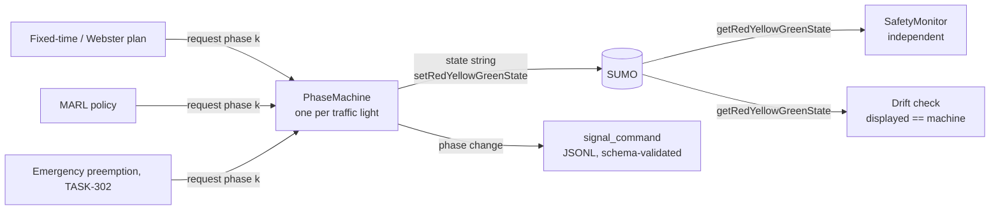
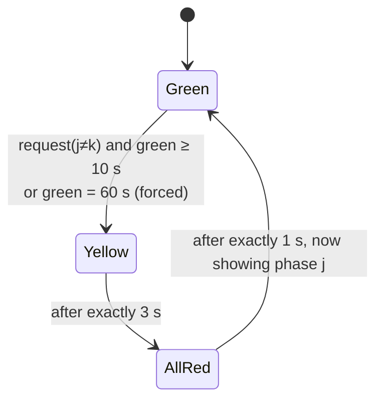

# Signal control layer: phase machine, safety monitor and baselines

*Module:* `ai/src/corridor_ai/sim/` and `ai/src/corridor_ai/control/` · *Owner:* Demir Cücü · *Task:* TASK-301a

Every controller in this project goes through this layer: fixed-time, Webster, MARL, and later the emergency green corridor. The layer enforces the signal safety limits of the project specification, so no controller can violate them. A separate component checks the result independently.

| Limit | Value |
|---|---|
| Minimum green | 10 s |
| Maximum green | 60 s |
| Yellow | 3 s (exactly) |
| All-red clearance | 1 s (exactly) |

The configuration loader (`common/config.py`, `SignalLimits`) refuses any configuration that relaxes these values. Limits may be tightened, e.g. min green 15 s.

---

## 1. The problem in the legacy prototype

The prototype environment (`ai/prototype/envs/sumo_marl_env.py`) changed signals with `traci.trafficlight.setPhase(tls, i)`. That only moves SUMO's *own* program to phase *i*. The program keeps its own timer and advances to the next phase when the phase duration expires, regardless of the controller. The prototype never pinned the duration, so SUMO and the controller drifted apart.

Measured in a 600 s headless run where every agent always chose *keep*: the controller's phase state differed from SUMO's actual phase in **239 of 360 checks (66 %)**. The prototype's evaluation results therefore did not measure the learned policy (see `ai/README.md`, Known issues).

## 2. Design



### 2.1 Why `setRedYellowGreenState`

There are two ways to take control of a SUMO traffic light:

| Option | How it works | Verdict |
|---|---|---|
| `setProgramLogic` + `setPhase` + `setPhaseDuration` | Install a controller-owned program and keep pinning the current phase's duration | Still couples us to SUMO's phase timer. Every step must re-pin, which is the same fragility that caused the bug |
| **`setRedYellowGreenState` driven by our own phase machine** | Set the full signal string. SUMO switches the light to its special `"online"` program, which holds the state until it is changed | **Chosen.** SUMO never advances by itself, the controller is the only source of truth, and all controllers share one implementation of the safety rules |

The chosen design also mirrors the hardware architecture. The ESP32 relay board receives *commands*, not programs (`signal_command` contract), and its interlock is authoritative.

### 2.2 Allowed green states (`sim/tls_model.py`)

For each traffic light, the allowed green states are the green phases of the network's own program (states with `G`/`g` and no yellow), deduplicated in program order. A controller can only *request one of these by index*. It can never build its own combination of green links, so it only ever shows phase combinations the network designer approved.

| Light | Allowed green states |
|---|---|
| toy corridor J1…J6 | `GGgrrrrGGgrrrr` (side streets), `rrrGGGgrrrGGGg` (arterial) |
| osm `lozan` | 4 green phases, incl. a short protected one (6 s in the original) |
| osm `montro` | 3 green phases (the third was 6 s in the original, below min green) |

Phases without any green or yellow are all-red clearances or red-only pedestrian phases. They are not green states. **ASSUMPTION:** no pedestrians are simulated in the placeholder fixtures, so red-only pedestrian phases are not modelled. This affects three background lights in `osm_alsancak_v0` that have a single vehicle green: they stay green.

### 2.3 Phase machine (`sim/phase_machine.py`)

One `PhaseMachine` per traffic light. Every simulated second (step length 1 s):

1. controllers call `request(k)` (switch to green *k*) or `request(None)` (keep);
2. `next_state()` applies the timing rules and returns the state to display during the coming second;
3. the simulation core sends it to SUMO with `setRedYellowGreenState` (only when it changed) and advances one second.



| Rule | Behaviour |
|---|---|
| Min green | A switch request before 10 s of green is **deferred**, not rejected, and served at 10 s |
| Max green | At 60 s the machine switches to the pending request, or to the next phase in cyclic order if there is none (**ASSUMPTION**) |
| Yellow | Exactly 3 s |
| All-red | Exactly 1 s |
| Requests during a transition | Kept as pending, served after the new green's minimum |
| Keep | Clears any pending request |
| Single-phase light | Stays green (nothing conflicts with it); exempt from max green |

**Transition states.** Mode `limits.all_red_mode`:

- `full` (default, the literal reading of the specification): every green link shows yellow for 3 s, then **every** link is red for 1 s.
  Example: `GGgrrrrGGgrrrr` → `yyyrrrryyyrrrr` (3 s) → `rrrrrrrrrrrrrr` (1 s) → `rrrGGGgrrrGGGg`.
- `conflicting_only` (option): a link keeps its green through the change only if it is green in both phases **and** is not downgraded from protected `G` to permissive `g`. All other green links get yellow, then red. If a change would show no yellow at all (nothing loses its green), the full sequence is used instead. This guarantees that every change has a visible yellow and all-red. A property-based test found this case.

### 2.4 Independent safety monitor (`sim/safety_monitor.py`)

The monitor reads the state SUMO **actually displays** each second, through `getRedYellowGreenState`, not the machine's bookkeeping. Each second's state is classified as `green(k)` (equal to allowed green *k*), `yellow` (contains `y`), or `clearance` (anything else). It checks:

| Rule | Check |
|---|---|
| `conflict` | No two **foe** links both show priority green `G` (every second) |
| `min_green` / `max_green` | Every green run lasts 10–60 s. The final run, truncated by the end of the simulation, is only checked against the maximum |
| `yellow` | Every yellow run lasts exactly 3 s |
| `all_red` | Every clearance run lasts exactly 1 s and, in `full` mode, is entirely red |
| `sequence` | green → yellow → clearance → green, no shortcuts |
| `green_to_red` | No link goes from green straight to red |

**Foe matrix.** Two links are foes if they belong to the same junction and SUMO's right-of-way matrix (`<request foes=…>` in the `.net.xml`) marks them as conflicting. Permissive green `g` (yield) next to a foe's `G` is allowed, because that is how SUMO models e.g. permissive left turns. Validation: none of the 35 lights' original green states (6 toy + 29 OSM) trigger a conflict, while the union of two phases does (unit test).

### 2.5 Drift check

After every simulated second, the core compares the state each light displays with the state its machine produced. A mismatch is *drift*, the prototype's bug. It must be **0**.

## 3. Baselines

All baselines use the same phase machine, so they obey the same limits as MARL.

### 3.1 Fixed-time (`control/fixed_time.py`)

- **Plan:** the original phase order of the network program. Each green is the original duration clamped to [10, 60] s. Yellow 3 s and all-red 1 s are inserted between greens.
- **Cycle:** C = Σ g + K · (3 + 1).
- **Offsets:** 0 at every light (**ASSUMPTION:** no coordination).

| Fixture / light | Original greens (s) | Fixed-time greens (s) | Cycle (s) |
|---|---|---|---|
| toy J1…J6 | 42, 42 | 42, 42 | 92 |
| osm `alsancak_station` (candidate) | 42, 42 | 42, 42 | 92 |
| osm `lozan` | 20, 6, 20, 20 | 20, **10**, 20, 20 | 86 |
| osm `montro` | 33, 33, 6 | 33, 33, **10** | 88 |
| osm `basmane` (9 Eylül, ASSUMPTION) | 39, 38 | 39, 38 | 85 |
| osm `cankaya` (candidate) | 39, 39 | 39, 39 | 86 |
| osm `konak_pier` (candidate) | 27, 6, 27, 6 | 27, **10**, 27, **10** | 90 |

Bold values were raised to the 10 s minimum, which fixes Montrö's 6 s green. Background lights (not agents) always run their fixed-time plan. The plan used in each evaluation is saved to `plans.json` in the evaluation output folder.

The toy corridor's plan comes from netconvert defaults (42/42 s) and is **not tuned to demand**. It is a weak baseline. Webster (below) is the meaningful reference.

### 3.2 Webster (`control/webster.py`)

For a light with K green phases and lane flows q_l (veh/h):

$$y_k = \max_{l \in \text{lanes}(k)} \frac{q_l}{s}, \qquad Y = \sum_k y_k, \qquad L = K\,(t_\text{yellow} + t_\text{all-red})$$

$$C_0 = \frac{1.5\,L + 5}{1 - Y}, \qquad C = \operatorname{clamp}\!\big(C_0,\; K\,g_\text{min} + L,\; \min(C_\text{max}, K\,g_\text{max} + L)\big), \qquad g_k = \operatorname{clamp}\!\Big((C - L)\,\frac{y_k}{Y},\; 10,\; 60\Big)$$

**Calibration:** flows q_l = distinct vehicles per incoming lane, counted for 3600 s after warm-up under the fixed-time plan, on **calibration seed = evaluation seed + 100000**. Flows are never measured on the evaluation seed itself.

| Parameter | Value | Status |
|---|---|---|
| Saturation flow s | 1800 veh/h/lane | **ASSUMPTION** until `analysis/` (Ayça) provides values |
| Lost time per phase | 4 s = yellow + all-red (start-up loss = end gain) | **ASSUMPTION** |
| C_max | 150 s | **ASSUMPTION** |
| Lanes served by several phases | Counted in each | **ASSUMPTION** |

Example (toy corridor, seed 1000): Y ≈ 0.40–0.44, C₀ ≈ 29–31 s, greens about 18 s arterial / 10 s side street, cycle about 36 s. When the clamping to 10 s raises a green, the realised cycle is slightly longer than C.

The *local adaptive Webster fallback* required by the risk plan (network or central link failure, diverging policy) reuses this computation on a rolling window of measured flows. It is wired into the arbiter in TASK-302.

### 3.3 Actuated reference (not a baseline)

`evaluate.py --controllers actuated` runs the network's own SUMO programs without the phase machine. It is reported **for reference only**. These programs do not meet the safety limits (no all-red, 6 s yellow in the OSM fixture), and the monitor reports their violations.

## 4. Output: `signal_command`

`control/command_sink.py` emits one `signal_command` (shared/contracts, DRAFT v0.1.0) whenever the machine of an **agent** intersection starts a phase change. Each message is validated against the JSON Schema before it is written as JSON lines.

| Field | Value | Status |
|---|---|---|
| `phase_id` | Green-phase index in the fixture program, as a string | **ASSUMPTION** until the phase-id format is agreed with Tolga |
| `green_duration_s` | Planned green for plan controllers; min green (10 s) for adaptive control, i.e. the committed minimum, extendable up to 60 s | **ASSUMPTION** |
| `valid_for_ms` | Decision interval for adaptive control | — |
| `sequence` | Increases monotonically per intersection | — |
| `transition` | `{yellow_s: 3, all_red_s: 1}` | — |

## 5. Verification

| Test | What it shows | Result |
|---|---|---|
| `tests/integration/test_no_phase_drift.py` | 3600 s on both fixtures (keep-only, fixed-time, random legal MARL actions in both all-red modes): displayed == machine state every second for every light; every light on the `"online"` program; 0 monitor violations | **0 mismatches** (e.g. 104,400 checks on the OSM fixture per run) |
| `tests/unit/test_phase_machine.py` | Exact timing sequences, deferral, forced switch, single phase. Property test: 150 random request sequences × both modes → 0 violations | pass |
| `tests/unit/test_safety_monitor.py` | Each rule is detected on a crafted violating sequence | pass |
| `tests/unit/test_tls_model.py` | Original green states conflict-free; a phase union is detected | pass |
| `tests/integration/test_env_and_metrics.py` | Webster plan safe; `signal_command` log schema-valid with monotonic sequence | pass |

Run the tests:

```bash
cd ai && python -m pytest tests -m "not sumo"   # unit tests, no SUMO (CI)
cd ai && python -m pytest tests -m sumo         # SUMO integration tests (~30 s)
```

## 6. Limitations and open points

- `phase_id` format and phase-order constraints on the ESP32 are open (request to Tolga).
- Saturation flow and lost time for Webster are assumptions (request to Ayça).
- Offsets and coordination between fixed-time lights are not modelled.
- Pedestrian phases are not modelled in the placeholder fixtures.
- Placeholder fixtures only; results are relative improvements on a placeholder fixture, not the real digital twin.
