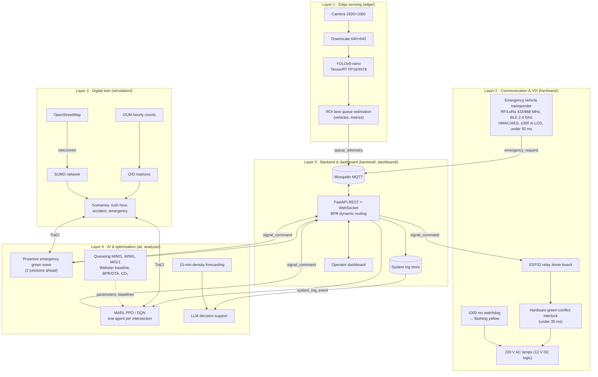
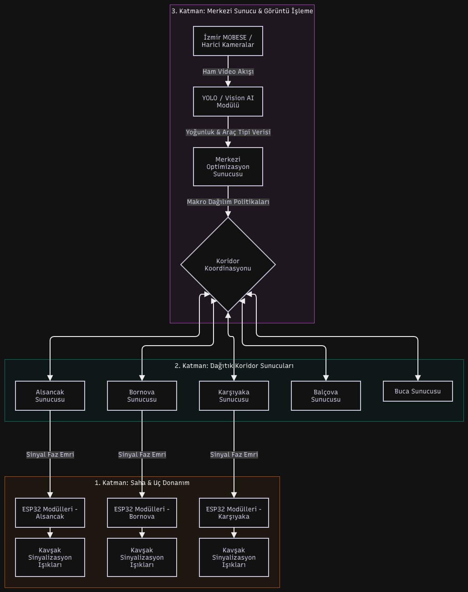
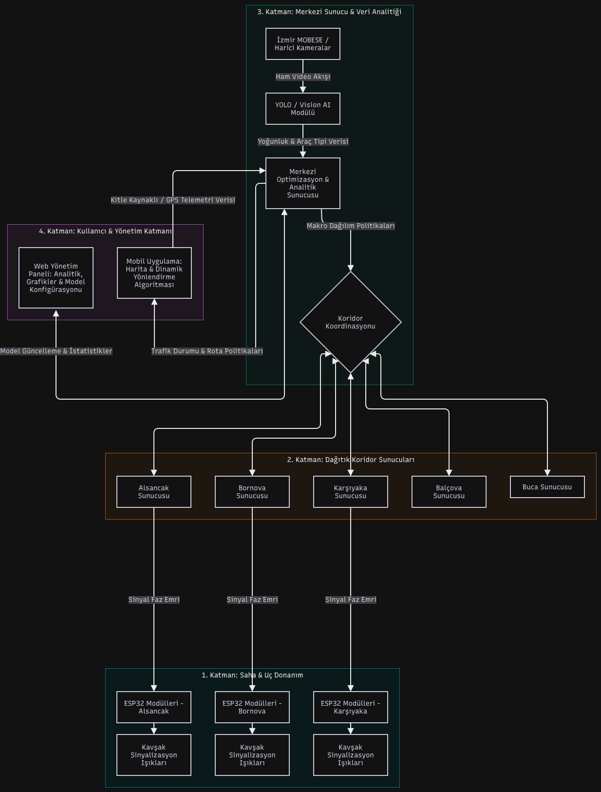

# Architecture overview

This page describes the system in two views:

1. the **functional view**: five layers and the data flowing between them;
2. the **deployment view**: the team's diagrams in [`diagrams/`](diagrams/).

## 1. Functional view (five layers)

### Layer summaries

| Layer | Owner(s) | Inputs | Outputs |
|---|---|---|---|
| 1. Edge sensing | Nihat | Camera frames | `queue_telemetry` over MQTT (target latency under 85 ms) |
| 2. Communication / V2I | Tolga | Transponder frames, `signal_command` | Verified emergency requests (through the backend), lamp states. Hardware interlock under 35 ms, watchdog 1000 ms |
| 3. Digital twin | Öykü | OSM, IZUM counts | SUMO network, routes, scenarios, TraCI access |
| 4. AI & optimisation | Demir (`ai/`), Ayça (`analysis/`) | Telemetry, emergency requests, SUMO state, logs | `signal_command`, forecasts, operator briefings; analytical baselines |
| 5. Backend & dashboard | Ario | All MQTT traffic | REST/WebSocket APIs, routing, log store, dashboard |

### Safety and fallback behaviour

- Signal limits for every controller: **min green 10 s, max green 60 s, yellow 3 s, all-red 1 s**.
- The **hardware interlock** rejects conflicting greens regardless of the command it receives.
- The **watchdog** switches to flashing yellow if the controller stops responding for 1000 ms.
- If the **network or central link fails**, intersections fall back to local adaptive Webster mode.
- If the **MARL policy diverges**, actions are clamped to the agreed green-time bounds.

## 2. Deployment view (team diagrams)

| Diagram | Source |
|---|---|
|  | [`System-Arch.drawio`](diagrams/System-Arch.drawio) |
|  | [`Web-Mobile-Arch.drawio`](diagrams/Web-Mobile-Arch.drawio) |

The diagrams (labels in Turkish) show four deployment tiers:

1. **Field and edge hardware**: ESP32 modules and the signal heads at each intersection.
2. **Distributed corridor servers**: regional servers (Alsancak, Bornova, Karşıyaka, Balçova, Buca) that send signal-phase commands to the ESP32 modules.
3. **Central server and analytics**: camera streams → YOLO/vision module → central optimisation and analytics server → corridor coordination. This tier issues macro distribution policies.
4. **User and management tier**: the web management panel (analytics, charts, model configuration) and the **mobile app** (map and dynamic routing, crowd-sourced GPS telemetry; owner TBD).

### Open questions on the architecture

- **Where vision inference runs.** The diagrams place the YOLO module on the central server; the project specification places YOLOv8-nano on edge devices (Jetson / Raspberry Pi). Which is the target deployment, or is the central one only for the IZUM stream prototype? (Nihat, Ario)
- **Regional servers vs. a single backend.** How do the regional corridor servers relate to the FastAPI backend? (Ario)
- **Mobile app** has no owner yet.
